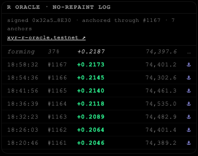

# XYR Shield

**Prove trading data is honest without revealing the strategy behind it.**

Built for the NEAR HACKATHON (Privacy & Private AI).

Strategy and indicator sellers have two problems they can't fix at the same time:

- **Buyers don't trust track records.** Losing trades get deleted, winners get backdated, and indicators repaint their history.
- **Sellers can't open the books.** Publishing every trade or the indicator formula gives the edge away.

XYR Shield separates *what is proven* from *what is shown*:

| Component | Stays private | Is proven on NEAR |
|---|---|---|
| **Shielded trade log** | every trade (time, side, price, fill) | that each trade existed at that moment and was never edited, deleted or backdated |
| **Private stats API** | the individual trades behind the answer | the answer came from a TEE-attested model (signed receipts) |
| **R oracle** | how R is computed (model and settings) | that published R history is never repainted |

## How it works

```
strategy ──record──► vault (payload + salt, private) ──sha256──► NEAR ShieldLog.commit(hash)
              └──► Hyperliquid testnet order ──fill──┘   (the fill is part of the committed payload)

buyer agent ──/ask──► NEAR AI Cloud (TEE) : question → filter
                      stats over the vault (aggregates only, ≥5 trades per slice)
                      NEAR AI Cloud (TEE) : aggregates → answer
              ◄────── answer + TEE signatures checked against the hardware attestation

R model (private plug-in) ──closed bar──► hash chain: link_i = sha256(link_{i-1} : bar_i)
                                          chain head ──every 5 min──► NEAR ShieldLog.commit(head)
```

### 1. Shielded trade log (commit and reveal)
- Each record is stored privately as `payload + random salt`. Only `sha256(payload:salt)` goes to the `ShieldLog` contract, which records the block time and a sequence number `n`.
- **Reveal:** the owner can hand any trade's `payload + salt` to an auditor. `python -m shield.verify bundle.json` recomputes the hash, finds it on NEAR and reports the lag between the record and its commit. If the lag is under 2 minutes the trade was `called_live`.
- **Completeness:** the payload contains `seq`, so revealing `0..N-1` against the on-chain count proves no trade was dropped.
- **Real fills:** with `SHIELD_EXEC=on`, each record is traded on the **Hyperliquid testnet** (Hyperliquid is the venue NEAR's perps route to). The fill (order ID, average price, size, fee) is vaulted and committed with the record, so it covers what actually traded, including slippage and fees.

### 2. Private stats API with attested AI
- `GET /stats` returns aggregates only (PF, win rate, average and total bp, longest losing streak). Any slice with fewer than 5 trades is refused, so buyers can't isolate individual trades.
- `POST /ask` takes plain English. The question goes **only to TEE-attested models** on NEAR AI Cloud, and the node refuses non-attested ones. The model turns the question into a filter, the stats are computed locally, and the model phrases the answer. Raw trades never reach the model.
- Every model call returns a **receipt**: the TEE's ECDSA signature over `model:sha256(request):sha256(response)`. The signer is checked against the `signing_address` in the model's hardware attestation (Intel TDX + NVIDIA).

### 3. R oracle with a no-repaint proof
- `GET /r` returns the latest closed R and the forming R (clearly marked as not final), **signed** with the node's key (EIP-191).
- Every closed bar is appended to a hash chain, and the chain head is anchored on NEAR every 5 minutes.
- `python -m shield.rverify` downloads the history, recomputes every link, checks each anchor on NEAR and checks the live signature. `--tamper` changes one anchored R by 0.0001 locally and shows the proof failing from that bar onward.
- **The R model is a plug-in** (`shield/rmodel.py`, set with `RNODE_MODEL=pkg.module:Class`). This repo ships a plain RSI stand-in. The production model lives in a private module that is never published, and the verifier doesn't need it.

## Live on NEAR testnet

| Contract | What it holds |
|---|---|
| [`xyr-shield.testnet`](https://testnet.nearblocks.io/address/xyr-shield.testnet) | 233 fingerprints of a strategy's historical records (backfilled, so marked late) |
| [`xyr-shield-hft.testnet`](https://testnet.nearblocks.io/address/xyr-shield-hft.testnet) | live records from a fast strategy, each committed 2–3 s after it fired |
| [`xyr-r-oracle.testnet`](https://testnet.nearblocks.io/address/xyr-r-oracle.testnet) | R chain-head anchors, every 5 minutes |

Contract source: `contract/src/contract.js` (near-sdk-js). It is append-only, only the owner can commit, it rejects duplicates and it emits `EVENT_JSON` logs.



## Run it

```bash
python3 -m venv .venv && .venv/bin/pip install -r requirements.txt
(cd chain && npm install)

# offline: local hash chain, synthetic sample data
export SHIELD_API_KEYS=demo SHIELD_ADMIN_KEY=adm
.venv/bin/python -m shield.backfill --file docs/sample_data.txt
.venv/bin/python -m shield.server --data-file my_data.txt           # API on :8787
curl -H "X-Api-Key: demo" "localhost:8787/stats?side=short&fee_bp=10"
curl -H "X-Api-Key: adm" localhost:8787/reveal/5 > b.json && .venv/bin/python -m shield.verify b.json

# R oracle (public RSI stand-in)
.venv/bin/python -m shield.rnode                                     # :8790
.venv/bin/python -m shield.rverify && .venv/bin/python -m shield.rverify --tamper
```

**Feed it any strategy.** Append one line per data point to a file and pass it as `--data-file`. The strategy itself never touches this repo:
```
DATA   | ENTRY_LONG | 2026-11-11 15:47:13Z | price=73794.4 | R=+0.0889 | Rmode=HOLD | reason
```

**On NEAR testnet:** create an account (`near account create-account sponsor-by-faucet-service <name>.testnet …`), then run `cd contract && npm install && npm run build` and `cd chain && node near.mjs deploy ../contract/build/shield_log.wasm`. Set `SHIELD_CHAIN=near` plus the `NEAR_*` variables (see `.env.example`).

**Attested `/ask`:** set `NEARAI_API_KEY`, then send `POST /ask {"question": "How do shorts do after a 10 bp fee?"}`.

| Endpoint | Auth | |
|---|---|---|
| `GET /log` | public | commitment hashes and NEAR receipts |
| `GET /stats` | key | aggregates only |
| `POST /ask` | key | attested-AI answer with TEE receipts |
| `POST /demo-record` | owner | commit one record now (excluded from stats) |
| `GET /reveal/{seq}` | owner | reveal bundle for one trade |
| `GET /owner-log` | loopback | the owner's own view: trades with their NEAR tx links |
| `GET /r`, `/r/history`, `/r/anchors`, `/r/key` | public | R oracle |

## Data, not advice
XYR Shield publishes **data**: commitments, aggregate statistics about past records, and indicator values with proof of their history. It does not give buy or sell recommendations or investment advice, and it doesn't manage anyone's money. Past statistics say nothing about future results. Anyone using the data is responsible for their own decisions.

## Honest limits
- **Computation isn't attested.** The strategy and R model run on the operator's machine, not in a TEE. NEAR proves *when* a value was committed and that it never changed afterwards. It does not prove *how* the value was computed. NEAR AI Cloud attests LLM inference only.
- **Backfilled history** is committed late, and the verifier marks it `called_live: false`. Only live commits prove real-time calls.
- **Testnet fills are visible** on Hyperliquid's explorer to anyone who knows the address. Fully private execution needs NEAR's confidential perps (mainnet).
- **Differencing attacks:** overlapping `/stats` queries can narrow trades down. The fix is noise or a query budget per key.
- **No payments yet:** API keys only. Next: x402 / NEAR payments per `/ask`.
